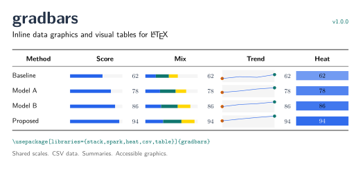
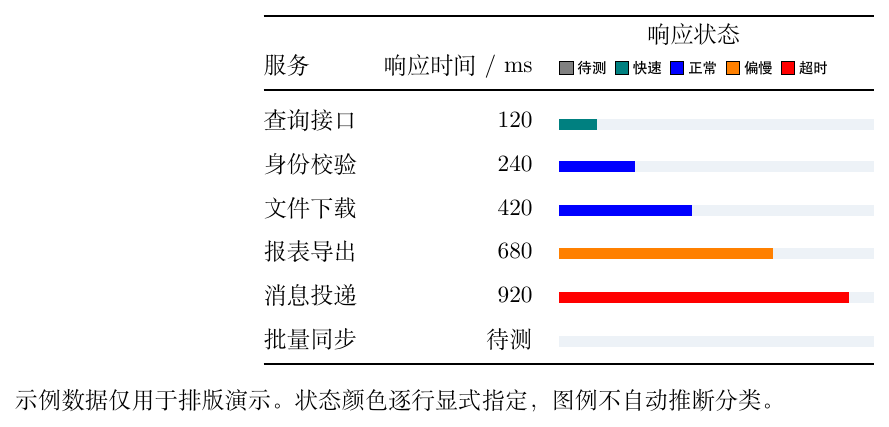

# gradbars

**Inline data graphics for LaTeX text and tables.**

**v1.1.1 · pdfLaTeX / XeLaTeX / LuaLaTeX · MIT**

Development snapshot, dated 2026-10-27; no v1.1.1 release has been published. Fixes source extraction, archive checks and documentation consistency, and adds opt-in assembled header legends while retaining existing interfaces and default data semantics. Downloads below still refer to the published v1.1.0.

[简体中文](README.md) · [Published English manual (v1.1.0)](https://github.com/Tape5try/gradbars/releases/download/v1.1.0/gradbars-manual-en-v1.1.0.pdf) · [Published Chinese manual (v1.1.0)](https://github.com/Tape5try/gradbars/releases/download/v1.1.0/gradbars-manual-v1.1.0.pdf) · [CTAN](https://ctan.org/pkg/gradbars)



Built on PGF/TikZ, gradbars embeds graphics in existing `tabular` cells or builds visual tables through declared `gradtable` columns and data rows. No `tikzpicture` wrapper or shell escape is required.

## Features

- **Inline graphics:** data bars, signed bars, lollipops, comparisons, dumbbells, bullet charts, intervals, stacks, sparklines and heat cells.
- **Visual tables:** automatic widths, independent header alignment, spanning headers, groups, best/second-best marking, summaries and pagination.
- **Data handling:** CSV field binding, sorting, filtering, grouping, automatic column ranges and named shared scales.
- **Numbers and appearance:** scientific input, optional siunitx formatting, decimal alignment, themes, patterns, table styles and legends.
- **Accessibility and extensions:** automatic graphic alternative text when LaTeX PDF tagging is enabled, with `alt` overrides; stable registration interfaces for scalar graphics, formatters and contributed libraries.

## Service response times and status legend (v1.1.1)



Actual output from `service-response-legend-v1.1.1`. `\gradtablelegendhead` combines the title and horizontal swatches in a table heading; `table legend=false` hides the legend row while retaining the title. Colors are assigned explicitly for each row, and unmeasured data use `NA`.

[Complete example source](docs/examples/service-response-legend.tex) · [Rebuild the image](docs/images/service-response-legend.md)

## Installation

Requires LaTeX 2025-11-01+, expl3 2025-12-29+ and PGF/TikZ 3.1.11a+.
Update older distributions before installing this release.

The package is available on CTAN. For TeX Live or MacTeX managed by `tlmgr`:

```sh
tlmgr install gradbars
```

Update an installed copy or inspect package information:

```sh
tlmgr update gradbars
tlmgr info gradbars
```

The TeX Live repository may lag behind CTAN or the development repository. Check the installed version. For manual installation, copy all `.sty` files from `sty/`, including optional `tblrlibgradbars.sty`, beside your main `.tex` file, or install them in a local TEXMF tree under `tex/latex/gradbars/`. Do not copy only the entry file or mix module versions.

pdfLaTeX, XeLaTeX and LuaLaTeX are supported. Dependencies include PGF/TikZ, xparse and expl3; collected CSV columns and native tables additionally load collcell, array, booktabs, colortbl and longtable. siunitx is optional. The package itself does not load ctex or fontspec.

## Quick start

Compile this complete example:

```latex
\documentclass{article}
\usepackage{gradbars}
\begin{document}
\gradbar[max=100,width=30mm,precision=1]{72.4}

\begin{gradtable}[width=\linewidth,header align=c]
  \gradcolumn{method}{Method}
  \gradcolumn[type=bar,mark=both,
    options={max=100,precision=1}]{score}{Score}
  \gradcolumn[type=number,mark=best,
    options={better=lower,precision=1}]{time}{Time / ms}
  \gradrow{Baseline,72.4,18.2}
  \gradrow{Proposed,92.7,11.5}
  \gradrow{Pending,NA,NA}
\end{gradtable}
\end{document}
```

Higher scores and lower times are better. `mark=both` marks the best and second-best values. `NA` denotes missing data, not zero. For Chinese content, use an appropriate setup such as XeLaTeX with `ctexart`.

## Loading selected libraries

By default, `\usepackage{gradbars}` loads the five libraries `stack,spark,heat,csv,table`.
Load `distribution,legend,reports` explicitly when needed. Select libraries with:

```latex
\usepackage[libraries={stack,spark,heat,csv,table}]{gradbars}
```

| Library | Purpose |
| :---: | --- |
| `core` | Basic graphics, numbers, settings and accessibility tagging; always loaded |
| `stack` | Signed stacks, segment labels and legends |
| `spark` | Line, bar and win-loss sparklines |
| `heat` | Sequential and diverging heat cells |
| `csv` | CSV import, cell access and collected columns |
| `table` | Native visual tables; automatically loads the four feature dependencies above |

Use `libraries=none` for basic graphics only. Additional libraries must be loaded in the preamble:

```latex
\usepackage[libraries=none]{gradbars}
\usegradbarslibrary{stack,spark}
```

`all` and `none` are modes of the `libraries` option, not library names. Both `\gradbarsset` and `\gradbarssetup` set defaults within the current scope.

## Ordinary tables with numeric cells

```latex
\gradbarscolumn*{G}{max=1,width=14mm,precision=3,theme=gray}
\begin{tabular}{lGG}
Method & \gradbarshead{Precision} & \gradbarshead{Recall}\\
Alpha & 1.000 & 0.968\\
Beta & & 0.750\\
\end{tabular}
```

The starred form centers labels and keeps empty cells blank; `NA` remains missing. No user-written collector is needed. See [ordinary-table documentation](docs/tabular-columns.md) and the [complete example](docs/examples/precision-recall.tex).

Place a horizontal category legend below a heading without custom swatch macros or a nested table:

```latex
\gradbarssetup{table legend=true} % false hides the legend row, retaining the title
\gradtablelegendhead[
  stack colors={gray,teal,blue,orange,red}
]{Response status}{Pending,Fast,Normal,Slow,Timeout}
```

Use `\gradtablelegend[options]{names}` for the swatch row alone. Both commands are in core and need no `legend` library. Labels declare the categories; they do not change bar colors automatically. See the [complete service-response table](docs/examples/service-response-legend.tex) and [legend configuration](docs/legends.md).

## tabularray integration

With tabularray 2025C (2025-11-27) or newer, load the optional adapter in the preamble:

```latex
\usepackage{tabularray}
\usepackage{gradbars}
\UseTblrLibrary{gradbars}
```

`G[options]{width}`, `H[options]{width}`, `N[options]{width}` and `D[options]{width}` provide bars, heat cells, numbers and layered comparisons. Protect headers with `{...}`. Cell helpers such as `\gradbarTblr` also work with existing Q/X columns. `label align=cell` centers inside/auto labels across the content area; `label=left` preserves formatted numbers and units. The separate `gradtblr` environment supplies preset styling, while native gradtable supports `style=matrix`. Ordinary documents do not load tabularray automatically. Both manuals include a dedicated integration chapter.

## Data and layout conventions

- Use consistent ranges to compare the same metric. Automatic spark ranges emphasize shape; fix the scale to compare absolute levels.
- Formatting does not alter raw calculations. `unit` appends text; `value format=percent` computes the value relative to `max`.
- CSV accepts single-line comma-separated fields read as characters, not executed as TeX. Sparklines use equally spaced observations and do not parse dates.
- Signed stacks accumulate independently on each side of zero. The default total is the net sum; segment percentages represent shares of absolute contributions.
- `long=true` enables native table pagination. Place multipage tables in single-column body text, outside floats and minipages.
- Automatic alternative text covers graphics only. Document reading order, table structure and other accessibility requirements need separate validation.

The opt-in reports library provides [domain report presets](docs/reports.md). Contributors can use the [independent starter](docs/libraries/starter/README.md) and the [public scalar backend contract](docs/backends.md).

## Documentation and development

Both manuals pair rendered output with source and cover getting started, graphics, appearance, tables, applications and reference material.

- [Chinese main source](docs/gradbars-manual.tex) and [Chinese chapters](docs/Chapter/zh-cn/README.md).
- [English main source](docs/gradbars-manual-en.tex) and [English chapters](docs/Chapter/en/README.md).
- [API reference](docs/api.md), [developer guide](docs/developer.md), [v1.1.1 maintenance notes](docs/migration-v1.1.1.md) and [v1.1.0 migration guide](docs/migration-v1.1.0.md).
- [Stability contract](docs/stability.md) for public scope, precedence, compatibility and deprecation.
- [Published source guide (v1.1.0)](https://github.com/Tape5try/gradbars/releases/download/v1.1.0/gradbars-source-v1.1.0.pdf) for the l3doc and docstrip workflow; build the current guide locally.
- [Changelog](CHANGELOG.md) for additions, fixes and compatibility changes.

Runtime modules live in `sty/`; the contributed example lives in `docs/libraries/`. From the repository root, run:

```sh
l3build check
texlua tests/maintenance.lua
texlua scripts/docs-check.lua
texlua scripts/check.lua
texlua scripts/source.lua --check
l3build doc
```

The build uses TeX Live texlua, l3build and latexmk, without Python. The Chinese manual uses XeLaTeX; the English manual and source guide use pdfLaTeX. latexmk handles reruns automatically. PDFs are distributed as GitHub Release assets rather than committed to Git.

`gradbars.dtx` and `gradbars.ins` are reproducible distribution sources;
`texlua scripts/unpack.lua` creates `sty/` if needed and extracts all 22 runtime
modules there, leaving the source root free of `.sty` files. Alternatively,
retain the supplied `sty/README.md` and run `tex gradbars.ins`. Neither command
requires shell escape. After editing `sty/`, run
`texlua scripts/source.lua` to synchronize them. Inspect actual Figure alternatives
and tagged table spans/scopes with `texlua scripts/pdf-check.lua`.

See [release configuration](docs/developer.md#release-configuration). The CTAN source ZIP excludes
Python files and generated runtime modules; the development repository retains `sty/`.

## Feedback and license

Report problems through [GitHub Issues](https://github.com/Tape5try/gradbars/issues), including a minimal `.tex` example, engine, package version and relevant log.

Author and maintainer: SuFan (GitHub: Tape5try). The package and original sources
are licensed under [MIT](LICENSE). The attributed adaptation in the
[Precision/Recall example](docs/examples/precision-recall.tex) is CC BY-SA 4.0;
see its source header. This exception does not relicense the runtime.

[Distributions](docs/distributions.md) · [Shared legends](docs/legends.md) · [Accessibility scope](docs/accessibility.md)

The GitHub tree omits `.dtx/.ins` and local CTAN README templates. l3build and CI generate distribution sources from `sty/`; the CTAN entry is prepared from `README.en.md`.
