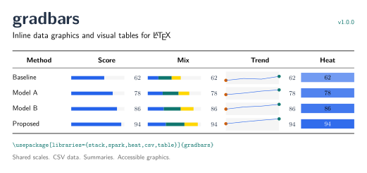
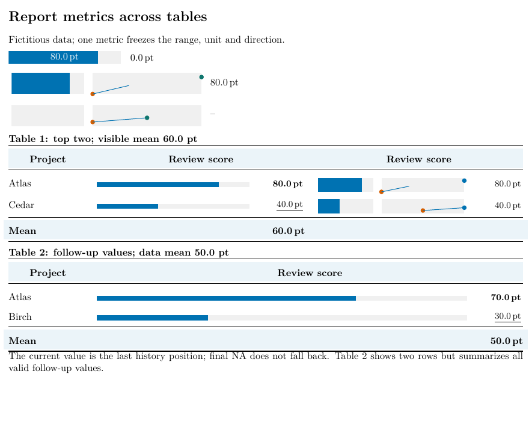
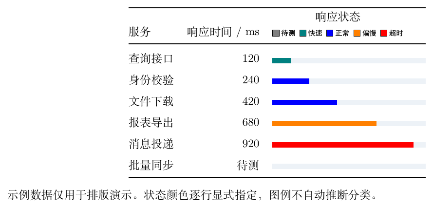
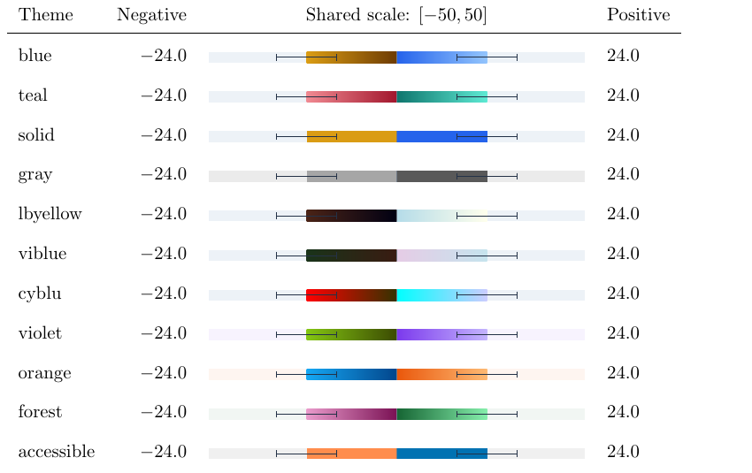
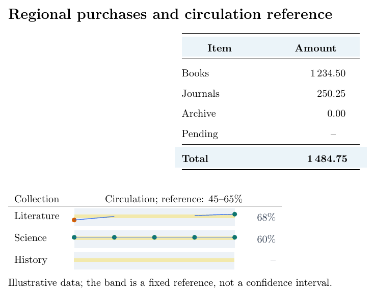
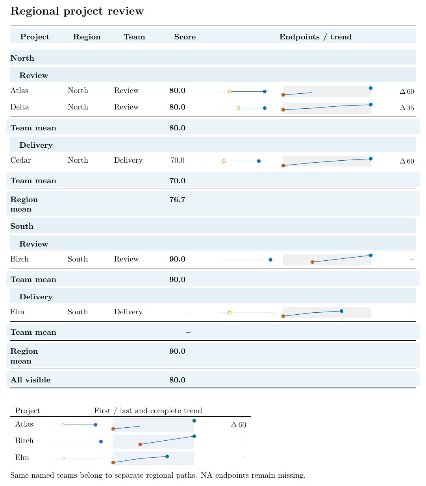
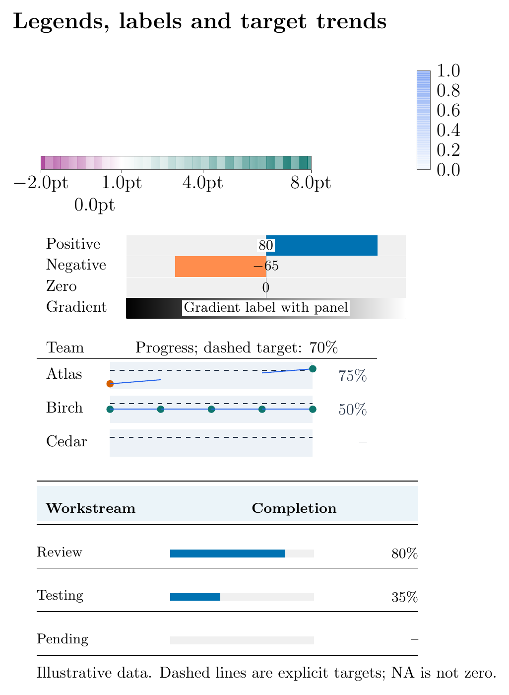

# gradbars

**Compact data graphics for values, comparisons, composition, trends and distributions in LaTeX text and tables.**

**v1.2.3 · Repository source · pdfLaTeX / XeLaTeX / LuaLaTeX · MIT**

[简体中文](README.md) · [Installation](#installation-and-selected-libraries) · [Examples](docs/examples/README.md) · [API reference](docs/api.md) · [Changelog](CHANGELOG.md) · [CTAN](https://ctan.org/pkg/gradbars)



Built on PGF/TikZ, gradbars embeds individual graphics in text and existing tables, or builds reports with declared `gradtable` columns, ranking, summaries and pagination. No `tikzpicture` wrapper or shell escape is required. All example data are illustrative.

## Quick start

Compile this complete example:

```latex
\documentclass{article}
\usepackage{gradbars}
\begin{document}
\gradbar[max=100,width=30mm,precision=1]{72.4}

\begin{center}
\begin{gradtable}[width=\linewidth,header align=c]
  \gradcolumn{method}{Method}
  \gradcolumn[type=bar,mark=both,
    options={max=100,precision=1}]{score}{Score}
  \gradcolumn[type=number,mark=best,
    options={better=lower,precision=1}]{time}{Time / ms}
  \gradrow{Baseline,72.4,18.2}
  \gradrow{Proposed,92.7,11.5}
  \gradrow{Pending,NA,NA}
\end{gradtable}
\end{center}
\end{document}
```

Higher scores and lower times are better. `mark=both` marks the best and second-best values. `NA` denotes missing data, not zero. For Chinese content, use an appropriate setup such as XeLaTeX with `ctexart`.

## Declare your own graphic command

Save a graphic's settings once, then supply values and optional per-call overrides:

```latex
\gradbarsnewcommand[
  type=bar,args={m O{}},data={#1},options={#2},empty=skip,
  theme=gray,min=0,max=1,width=25mm,height=5pt,precision=3,
  label position=right,label distance=1mm
]{\servicebar}

\servicebar{0.960}
\servicebar{0.720}[color=teal]
\servicebar{0.840}[fill=gradient,left color=blue,right color=cyan!20,
  label position=above,label reference=value,label yshift=2pt]
```

Signatures can use `{value}{options}`, `{value}[options]` or `[options]{value}`, and expose individual dimensions or colors. Native bar/Heat main labels support explicit sides, reference points, anchors, distances and dimensional offsets. Declarations and calls follow TeX scope.

[Complete example](docs/examples/custom-commands.tex) · [Options and limits](docs/api.md#command-declarations)

## Choose a graphic and table workflow

| Display | Entry point | Read more |
| --- | --- | --- |
| Values and signed changes | `\gradbar`, `\gradsignedbar` | [Signed themes](docs/examples/theme-complements.tex) |
| Paired observations, targets and intervals | `\gradcompare`, `\graddumbbell`, `\gradrange` | [API](docs/api.md) |
| Composition, ordered observations and color scales | `\gradstack`, `\gradspark`, `\gradheat` | [Examples](docs/examples/README.md) |
| Sample distributions | `\gradboxplot`, `\gradboxrug` | [Statistics and missing data](docs/distributions.md) |
| Widths, groups, ranking, summaries and pagination | `gradtable` | [Hierarchical tables](docs/hierarchical-tables.md) |
| CSV and reusable report metrics | `\gradbarsloadcsv`, `\graddeclaremetric` | [CSV](docs/Chapter/en/csv-en.tex) · [Report metrics](docs/report-metrics.md) |

Call graphics directly in ordinary `tabular` cells, or use collected columns:

```latex
\gradbarscolumn*{G}{max=1,width=14mm,precision=3,theme=gray}
\begin{tabular}{lGG}
Method & \gradbarshead{Precision} & \gradbarshead{Recall}\\
Alpha & 1.000 & 0.968\\
Beta & & 0.750\\
\end{tabular}
```

The starred form centers labels, leaves blank cells blank, and displays NA as missing. Use `baseline=text` to align graphic labels with neighboring plain numbers.

- For tabularray, load `\usepackage{tabularray}` and `\UseTblrLibrary{gradbars}` in the preamble, then use dedicated columns or cell helpers. [Integration](docs/Chapter/en/tabularray-en.tex)
- For pgfplotstable, load its explicit body-cell adapter; host headings stay intact. [Adapter contract](docs/pgfplotstable.md)
- Extend existing workflows with separate public graphic, formatter, column and backend contracts. [Columns](docs/column-adapters.md) · [Starter](docs/libraries/starter/README.md)

## Complete reports and gallery

Numeric pairs have independent registration with `\gradbarsdeclarepairtype`,
invocation with `\gradpairgraphic`, and scoped record access with
`\gradbarspairvalue`. Declare standard native two-value columns explicitly with
`\gradbarsdeclarepaircolumn`; cells contain `66/82` or `NA`. Use `paired-report`
for a report preset. Ordinary tabular and tabularray can call pair graphics with
explicit widths.

[Pair contract and limits](docs/pair-extensions.md) · [Complete paired report](docs/examples/paired-report.tex) · [Public extension library](docs/libraries/gradbars-contrib-pairs.sty)



Reuse metric units, ranges and formatting across tables. Gallery images come from real TeX compilation, with rebuildable sources.

[Complete report source](docs/examples/report-metrics.tex) · [Rebuild](docs/images/report-metrics.md) · [More complete examples](docs/examples/README.md)

<details>
<summary>More graphics, themes, service-response and hierarchical reports</summary>

### Service response times and status legend




Actual output from `service-response-legend-v1.1.1`. `\gradtablelegendhead` combines the title and horizontal swatches in a table heading; `table legend=false` hides the legend row while retaining the title. Colors are assigned explicitly for each row, and unmeasured data use `NA`.

[Complete example source](docs/examples/service-response-legend.tex) · [Rebuild the image](docs/images/service-response-legend.md)

More [complete table examples](docs/examples/README.md) cover course completion,
library borrowing channels, energy-use comparisons and batch dimensions, with
standalone sources and matching chapters in both manuals.

### Signed theme gallery



All rows use the built-in `\gradsignedbar[theme=blue,label=none]{-24}{24}`, sharing `min=-50,max=50,error=8,width=72mm` and changing only the theme name. The table supplies the adjacent numeric labels; negative values use complementary colors.

[Complete example](docs/examples/theme-complements.tex) · [Rebuild the image](docs/images/theme-complements.md)

### Regional input and hierarchical reports





- [Regional numeric input](docs/regional-input.md): explicit per-column separators and canonical values for selection, scales, ranking and summaries; new regional table preset.
- [Trend compositions](docs/trend-compositions.md): retaining NA positions and explicit shared ranges.
- [Two-level CSV reports](docs/hierarchical-tables.md): structured paths, parent/leaf ranks and independent summary scopes; new hierarchical preset and [multipage source](docs/examples/hierarchical-longtable.tex).
- Executable examples: [regional input](docs/examples/regional-input.tex) / [中文](docs/examples/regional-input-cn.tex), [hierarchical review](docs/examples/hierarchical-teams.tex) / [中文](docs/examples/hierarchical-teams-cn.tex).

### Readability and target trends



The new layout and contrast behavior are explicit. `\gradsparktarget` separates
reference targets from observations and preserves missing positions.
[Usage and limits](docs/readability.md) · [Source](docs/examples/readability-target.tex) · [Rebuild](docs/images/readability-target.md)

</details>

## Installation and selected libraries


Requires LaTeX 2025-11-01+, expl3 2025-12-29+ and PGF/TikZ 3.1.11a+.
Update older distributions before installing this release.

The package is available on CTAN. For TeX Live or MacTeX managed by `tlmgr`:

```sh
tlmgr install gradbars
```

Update an installed copy or inspect package information:

```sh
tlmgr update gradbars
tlmgr info gradbars
```

The TeX Live repository may lag behind CTAN or the development repository. Check the installed version. For manual installation, copy all `.sty` files from `sty/`, including optional `tblrlibgradbars.sty`, beside your main `.tex` file, or install them in a local TEXMF tree under `tex/latex/gradbars/`. Do not copy only the entry file or mix module versions.

pdfLaTeX, XeLaTeX and LuaLaTeX are supported. Dependencies include PGF/TikZ, xparse and expl3; collected CSV columns and native tables additionally load collcell, array, booktabs, colortbl and longtable. siunitx is optional. The package itself does not load ctex or fontspec.

The five default libraries are `stack,spark,heat,csv,table`. Load `distribution`, `legend`, `reports` and `pgfplotstable` explicitly when needed; tabularray uses its own library entry point.

```latex
\usepackage[libraries=none]{gradbars}
\usegradbarslibrary{stack,spark} % preamble only
```

Core is always loaded. Table automatically loads stack, spark, heat and csv. `all` and `none` are package-option modes, not library names. [Modules and installation](sty/README.md)

## Data and layout conventions

- Compare the same metric on a common scale. Formatting affects display, not raw selection, ranking, statistics or geometry.
- Zero is valid; NA is missing. CSV fields stay literal and never execute TeX; declare regional separators explicitly.
- Series use equally spaced positions and retain missing entries. Put native multipage tables in single-column body text with `long=true`.
- Graphic alternatives do not establish document-wide accessibility. Table structure and reading order require separate validation. [Scope](docs/accessibility.md)

## Documentation and development

- Current manual sources: [English main](docs/gradbars-manual-en.tex) · [English chapters](docs/Chapter/en/README.md) · [Chinese main](docs/gradbars-manual.tex) · [Chinese chapters](docs/Chapter/zh-cn/README.md).
- Published PDFs (v1.1.0): [English manual](https://github.com/Tape5try/gradbars/releases/download/v1.1.0/gradbars-manual-en-v1.1.0.pdf) · [Chinese manual](https://github.com/Tape5try/gradbars/releases/download/v1.1.0/gradbars-manual-v1.1.0.pdf). Build the repository version locally.
- Reference: [API](docs/api.md) · [Stability](docs/stability.md) · [v1.2.3 migration](docs/migration-v1.2.3.md) · [Changelog](CHANGELOG.md).
- Development: [Modules](sty/README.md) · [Developer guide](docs/developer.md) · [Performance](docs/performance-v1.2.2.md) · [Gallery source](docs/images/readme-gallery.tex).

From the repository root:

```sh
texlua scripts/source.lua --check
l3build check
texlua scripts/check.lua
texlua scripts/docs-check.lua
l3build doc
```

Edit runtime sources in `sty/`. Generate dtx/ins with `texlua scripts/source.lua`; source archives extract all matching modules with `texlua scripts/unpack.lua`. Builds use TeX Live texlua, l3build and latexmk without Python. See the [developer guide](docs/developer.md) for full validation, installation and delivery rules.

## Feedback and license

Report a minimal `.tex` example, engine, package version and relevant log through [GitHub Issues](https://github.com/Tape5try/gradbars/issues).

Author and maintainer: SuFan (GitHub: Tape5try). The package and original sources use [MIT](LICENSE). The attributed [Precision/Recall example](docs/examples/precision-recall.tex) is adapted under CC BY-SA 4.0; see its source header. This exception does not relicense the runtime.
