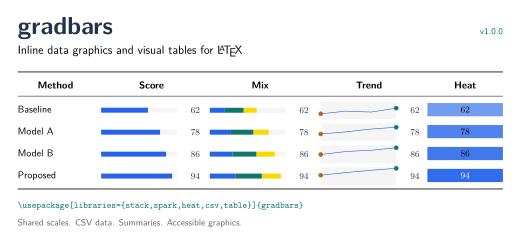

# gradbars

**在 LaTeX 正文和表格中呈现数值、比较、组成与趋势。**

**v1.0.0 · pdfLaTeX / XeLaTeX / LuaLaTeX · MIT**

计划发布日期：2026-10-30。

[English](README.en.md) · [中文手册](gradbars-manual-v1.0.0.pdf) · [英文手册](gradbars-manual-en-v1.0.0.pdf) · [CTAN](https://ctan.org/pkg/gradbars)



gradbars 基于 PGF/TikZ，既可将单个图形嵌入现有 `tabular`，也可通过 `gradtable` 声明列并填写数据，生成可视化表格。无需手动包裹 `tikzpicture`，无需开启 shell escape。

## 主要能力

- **内嵌图形**：数据条、正负条、棒棒糖、比较条、哑铃、子弹图、区间、堆叠条、趋势图与 Heat 色阶。
- **可视化表格**：自动列宽、独立表头对齐、多级表头、分组、最佳与次佳值标记、统计汇总和跨页排版。
- **数据处理**：CSV 字段绑定、排序、筛选、分组、自动列尺度和命名共享尺度。
- **数字与外观**：科学计数输入、可选 siunitx 格式化、小数点对齐、主题、纹理、表格样式与图例。
- **无障碍与扩展**：启用 LaTeX PDF tagging 后自动生成图形替代文本，支持 `alt` 覆盖；提供稳定的图形、格式化器和第三方库注册接口。

## 安装

支持 LaTeX 2025-11-01+、expl3 2025-12-29+ 和 PGF/TikZ 3.1.11a+。较旧发行版请先更新。

宏包已被 CTAN 收录。使用由 `tlmgr` 管理的 TeX Live 或 MacTeX 时：

```sh
tlmgr install gradbars
```

更新已安装的宏包或查看信息：

```sh
tlmgr update gradbars
tlmgr info gradbars
```

TeX Live 仓库中的版本可能晚于 CTAN 或仓库开发版，请核对安装版本。手动安装时，将 `sty/` 中全部 `.sty` 文件（包括可选适配库 `tblrlibgradbars.sty`）一起放到主 `.tex` 文件旁，或安装到本地 TEXMF 的 `tex/latex/gradbars/` 目录；不要只复制主文件或混用不同版本的模块。

支持 pdfLaTeX、XeLaTeX 和 LuaLaTeX。依赖包括 PGF/TikZ、xparse 和 expl3；CSV 收集列与专属表格还会加载 collcell、array、booktabs、colortbl 和 longtable。siunitx 为可选依赖，宏包本身不加载 ctex 或 fontspec。

## 快速开始

以下完整示例可直接编译：

```latex
\documentclass{article}
\usepackage{gradbars}
\begin{document}
\gradbar[max=100,width=30mm,precision=1]{72.4}

\begin{gradtable}[width=\linewidth,header align=c]
  \gradcolumn{method}{Method}
  \gradcolumn[type=bar,mark=both,
    options={max=100,precision=1}]{score}{Score}
  \gradcolumn[type=number,mark=best,
    options={better=lower,precision=1}]{time}{Time / ms}
  \gradrow{Baseline,72.4,18.2}
  \gradrow{Proposed,92.7,11.5}
  \gradrow{Pending,NA,NA}
\end{gradtable}
\end{document}
```

得分越高越好，耗时越低越好。`mark=both` 标记最佳与次佳值，`NA` 表示缺失而不是零。中文内容可使用 XeLaTeX 与 `ctexart`。

## 按需加载

默认 `\usepackage{gradbars}` 加载全部功能。也可显式选择库：

```latex
\usepackage[libraries={stack,spark,heat,csv,table}]{gradbars}
```

| 库 | 提供的功能 |
| :---: | --- |
| `core` | 基础图形、数值处理、设置和无障碍标记；始终加载 |
| `stack` | 正负堆叠、分段标签与图例 |
| `spark` | 折线、柱形与 win-loss 趋势图 |
| `heat` | 连续与发散色阶单元格 |
| `csv` | CSV 导入、单元格访问和收集列 |
| `table` | 专属可视化表格；自动加载前四个功能库 |

只需要基础图形时使用 `libraries=none`。后续库加载必须放在导言区：

```latex
\usepackage[libraries=none]{gradbars}
\usegradbarslibrary{stack,spark}
```

`all` 和 `none` 是 `libraries` 的模式值，不是库名。`\gradbarsset` 与 `\gradbarssetup` 均可设置当前作用域的默认选项。

## tabularray 集成

需要 tabularray 2025C（2025-11-27）或更新版本，在导言区加载：

```latex
\usepackage{tabularray}
\usepackage{gradbars}
\UseTblrLibrary{gradbars}
```

`G[选项]{宽度}`、`H[选项]{宽度}`、`N[选项]{宽度}`、`D[选项]{宽度}` 分别提供条形、Heat、数字和双层比较列。表头用 `{...}` 保护。`\gradbarTblr` 等单元格命令也可用于现有 `Q`、`X` 列；`label align=cell` 将 inside/auto 标签放在整个内容区域的中心，`label=left` 保留左侧格式化数值与单位。`gradtblr` 环境提供独立的预设样式，原生 `gradtable` 可使用 `style=matrix`。普通文档不自动加载 tabularray。完整示例见中英文手册的独立集成章节。

## 数据与排版约定

- 比较同一指标时使用一致的范围；自动趋势范围主要用于比较形状，比较绝对水平时应固定尺度。
- 数字格式化不改变原始数据计算。`unit` 附加文本，`value format=percent` 计算值相对于 `max` 的比例。
- CSV 接受逗号分隔的单行字段，字段按字符读取，不作为 TeX 执行。趋势图使用等间隔观测，不解析日期。
- 正负堆叠分别累积；默认标签为净值，分段百分比表示绝对贡献的份额。
- `long=true` 支持专属表格跨页；跨页表格应放在单栏正文中，不能置于浮动体或 `minipage`。
- 自动替代文本只覆盖图形；完整文档的阅读顺序、表格结构和其他无障碍要求需另行验证。

## 文档与开发

中英文手册均提供效果与源码对照，包含入门、图形、外观、表格、应用案例和参考。

- [中文主文件](docs/gradbars-manual.tex)与[中文章节](docs/Chapter/zh-cn/README.md)。
- [英文主文件](docs/gradbars-manual-en.tex)与[英文章节](docs/Chapter/en/README.md)。
- [API 参考](docs/api.md)、[开发者指南](docs/developer.md)和[迁移指南](docs/migration-v1.0.0.md)。
- [稳定接口契约](docs/stability.md)：公开接口范围、覆盖顺序、兼容性和弃用约定。
- [源码说明](gradbars-source-v1.0.0.pdf)：l3doc 文档与 docstrip 源码流程。
- [变更记录](CHANGELOG.md)：版本新增、修复与兼容性变化。

运行模块集中在 `sty/`，第三方库示例位于 `docs/libraries/`。从仓库根目录执行：

```sh
l3build check
python tests/run_tests.py
python scripts/build_source.py --check
python scripts/build_manual.py
```

构建脚本自动设置模块搜索路径，生成配套布局和中英文 PDF。中文手册需要 XeLaTeX、ctex/Fandol；英文手册使用 pdfLaTeX。Python 仅用于开发与构建，使用宏包时不需要。

`gradbars.dtx` 与 `gradbars.ins` 是可复现的发行源码；`tex gradbars.ins` 提取完整运行模块。
开发时修改 `sty/` 后运行 `python scripts/build_source.py` 同步发行源码。
使用 `python scripts/check_tagging.py` 检查 PDF 结构中的替代文本，开发环境需安装 `pypdf`。

## 反馈与许可

通过 [GitHub Issues](https://github.com/Tape5try/gradbars/issues) 报告问题，请附最小 `.tex` 示例、编译引擎、宏包版本和相关日志。

作者与维护者：SuFan（GitHub：Tape5try）。采用 [MIT 许可证](LICENSE)。
