# gradbars

**在 LaTeX 正文和表格中，用小型图形呈现数值、比较、组成、趋势与分布。**

**v1.2.3 · 仓库源码 · pdfLaTeX / XeLaTeX / LuaLaTeX · MIT**

[English](README.en.md) · [安装](#安装与按需加载) · [使用示例](docs/examples/README.md) · [API 参考](docs/api.md) · [变更记录](CHANGELOG.md) · [CTAN](https://ctan.org/pkg/gradbars)

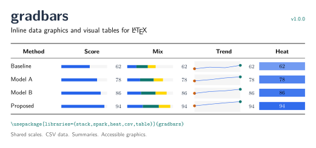

gradbars 基于 PGF/TikZ。单个图形可直接放进正文或已有表格，也可通过 `gradtable` 声明列并填写数据，生成带排名、摘要和分页的报告表格。无需手动包裹 `tikzpicture`，无需开启 shell escape。以下数据均为演示数据。

## 快速开始

以下完整示例可直接编译：

```latex
\documentclass{article}
\usepackage{gradbars}
\begin{document}
\gradbar[max=100,width=30mm,precision=1]{72.4}

\begin{center}
\begin{gradtable}[width=\linewidth,header align=c]
  \gradcolumn{method}{Method}
  \gradcolumn[type=bar,mark=both,
    options={max=100,precision=1}]{score}{Score}
  \gradcolumn[type=number,mark=best,
    options={better=lower,precision=1}]{time}{Time / ms}
  \gradrow{Baseline,72.4,18.2}
  \gradrow{Proposed,92.7,11.5}
  \gradrow{Pending,NA,NA}
\end{gradtable}
\end{center}
\end{document}
```

得分越高越好，耗时越低越好。`mark=both` 标记最佳与次佳值，`NA` 表示缺失而不是零。中文内容可使用 XeLaTeX 与 `ctexart`。

## 声明自己的绘图命令

把常用图形和外观声明一次，以后只填数值；用可选参数覆盖本次设置：

```latex
\gradbarsnewcommand[
  type=bar,args={m O{}},data={#1},options={#2},empty=skip,
  theme=gray,min=0,max=1,width=25mm,height=5pt,precision=3,
  label position=right,label distance=1mm
]{\servicebar}

\servicebar{0.960}
\servicebar{0.720}[color=teal]
\servicebar{0.840}[fill=gradient,left color=blue,right color=cyan!20,
  label position=above,label reference=value,label yshift=2pt]
```

`args` 支持 `{数值}{选项}`、`{数值}[选项]`、`[选项]{数值}` 等组合，也可将宽度、颜色分别设为参数。原生数据条和 Heat 的主数值标签可设置方向、参照点、锚点、间距及带单位的偏移。声明与调用遵循 TeX 作用域。

[中文完整示例](docs/examples/custom-commands-cn.tex) · [参数与支持范围](docs/api.md#command-declarations) · [中文分步教程源码](docs/Chapter/zh-cn/libraries-cn.tex)

## 选择图形与表格工作流

| 要呈现什么 | 使用入口 | 进一步阅读 |
| --- | --- | --- |
| 单个数值、正负变化 | `\gradbar`、`\gradsignedbar` | [主题与正负值示例](docs/examples/theme-complements.tex) |
| 两次观测、目标与区间 | `\gradcompare`、`\graddumbbell`、`\gradrange` | [API 参考](docs/api.md) |
| 构成、顺序观测、色阶 | `\gradstack`、`\gradspark`、`\gradheat` | [完整示例目录](docs/examples/README.md) |
| 样本分布 | `\gradboxplot`、`\gradboxrug` | [统计定义与缺失规则](docs/distributions.md) |
| 自动列宽、分组、排名、摘要、跨页 | `gradtable` | [层级表格](docs/hierarchical-tables.md) |
| CSV 与重复使用的报告指标 | `\gradbarsloadcsv`、`\graddeclaremetric` | [CSV](docs/Chapter/zh-cn/csv-cn.tex) · [报告指标](docs/report-metrics.md) |

普通 `tabular` 可直接调用绘图命令，也可用收集列让单元格只填数字：

```latex
\gradbarscolumn*{G}{max=1,width=14mm,precision=3,theme=gray}
\begin{tabular}{lGG}
Method & \gradbarshead{Precision} & \gradbarshead{Recall}\\
Alpha & 1.000 & 0.968\\
Beta & & 0.750\\
\end{tabular}
```

星号接口将标签放在单元格中心，空白保留为空白，`NA` 显示缺失。普通数字与图中数字需要文字基线对齐时，显式设置 `baseline=text`。

- 使用 tabularray：在导言区加载 `\usepackage{tabularray}` 与 `\UseTblrLibrary{gradbars}`，使用专用列或单元格命令。[集成说明](docs/Chapter/zh-cn/tabularray-cn.tex)
- 使用 pgfplotstable：显式加载适配库，为正文列绑定图形，保留宿主表头。[适配说明](docs/pgfplotstable.md)
- 扩展已有工作流：公开图形、格式化器、列适配和后端接口各有独立契约。[列适配](docs/column-adapters.md) · [扩展模板](docs/libraries/starter/README.md)

## 完整报告与效果

数值对扩展提供独立入口：`\gradbarsdeclarepairtype` 注册比较、哑铃或区间的消费者，
`\gradpairgraphic` 调用，`\gradbarspairvalue` 读取规范原值、缺失标记和几何记录。
原生表格使用 `\gradbarsdeclarepaircolumn` 显式声明标准双值列，填写 `66/82` 或 `NA`；
可选 `style=paired-report`。普通 `tabular` 与 tabularray 可直接调用并指定宽度。

[数值对契约与限制](docs/pair-extensions.md) · [中文配对报告](docs/examples/paired-report-cn.tex) · [公开扩展示例库](docs/libraries/gradbars-contrib-pairs.sty)

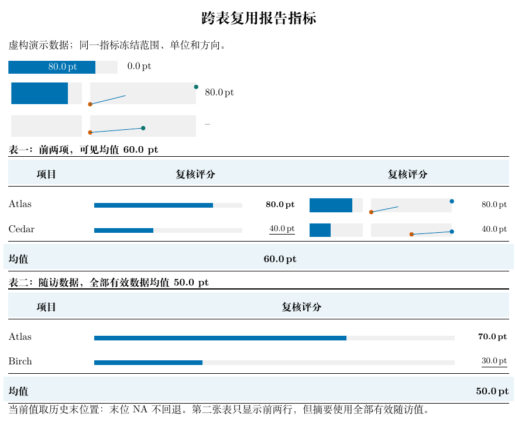

同一个指标可在多张表中共享单位、范围与格式。所有效果图来自真实 TeX 编译，保留可重建源码。

[报告指标完整源码](docs/examples/report-metrics-cn.tex) · [图片重建](docs/images/report-metrics.md) · [更多完整案例](docs/examples/README.md)

<details>
<summary>展开图形、主题、服务响应与层级报告效果</summary>


以下图片由宏包示例实际编译生成，使用演示数据。图形保留数值标签，可直接嵌入正文或表格；点击图片可查看大图。

### 正负同轨主题

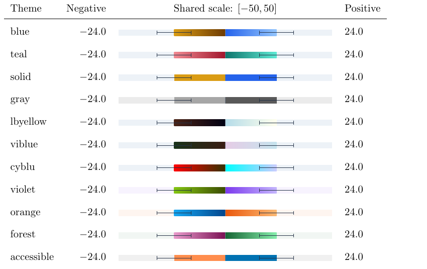

上图使用内置命令 `\gradsignedbar[theme=blue,label=none]{-24}{24}`；各行共用 `min=-50,max=50,error=8,width=72mm`，仅切换主题名称。两侧数值由表格单独显示，负值采用互补色。

[完整主题示例](docs/examples/theme-complements.tex) · [图片重建方法](docs/images/theme-complements.md)

### 内嵌图形：数值、比较、组成与趋势

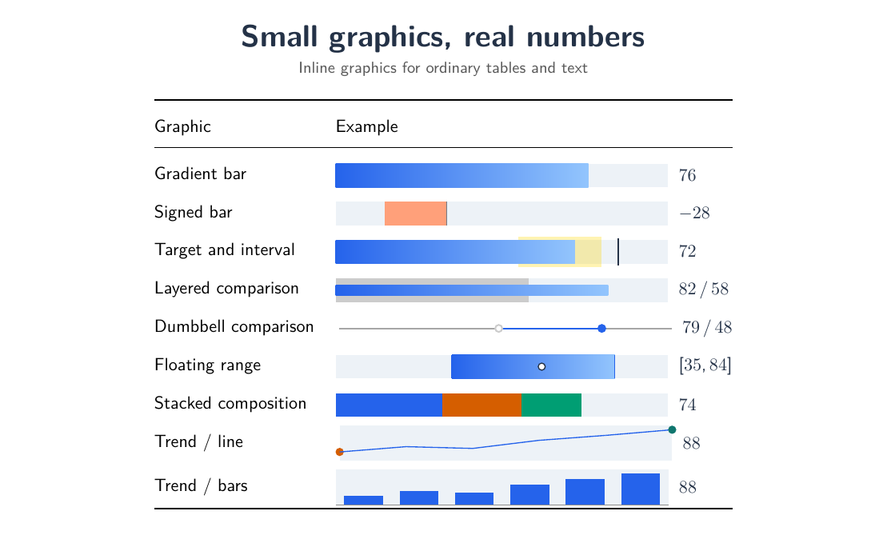

单个数据条只需 `\gradbar[max=100]{76}`；比较用 `\graddumbbell{48}{79}`，组成用 `\gradstack{32,24,18}`。相同宽度与范围便于在多行之间比较。

### 可视化表格：模型指标、相关矩阵与消融实验

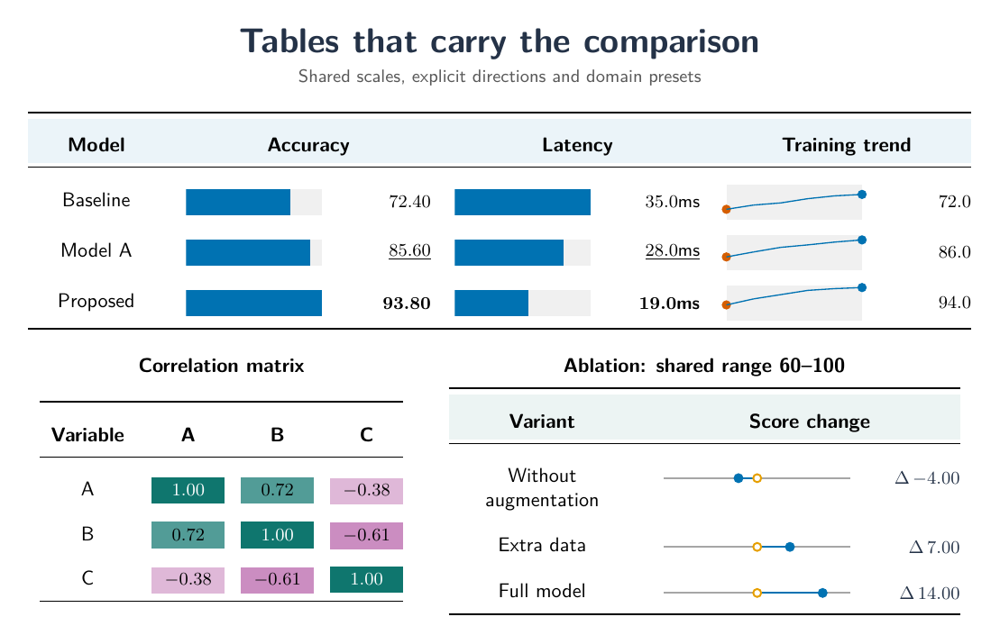

同一张表可同时呈现指标条、数值和训练趋势。可选 `reports` 库提供相关矩阵、消融实验和指标表预设；准确率越高越好、延迟越低越好，分别按原始数值判断。

[领域报告接口](docs/reports.md) · [完整报告示例](docs/examples/domain-reports.tex) · [普通表格只写数字的示例](docs/examples/precision-recall.tex)

### 分布统计：箱线图与统计摘要

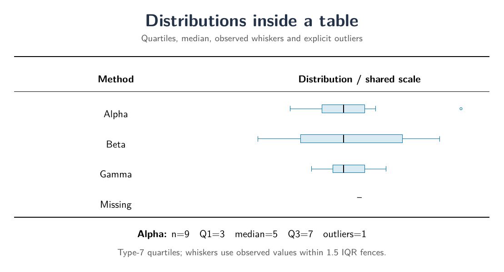

加载 `distribution` 后，`\gradboxplot{0,2,3,4,5,6,7,8,16}` 即可从样本绘制箱线图，也可直接填入表格列。四分位数采用 type-7 定义；须取 1.5 IQR 围栏内的实际观测，空心点表示离群点。`NA` 与零明确区分。

[统计定义与接口](docs/distributions.md)

### 配色与图例：一项设置切换完整色阶

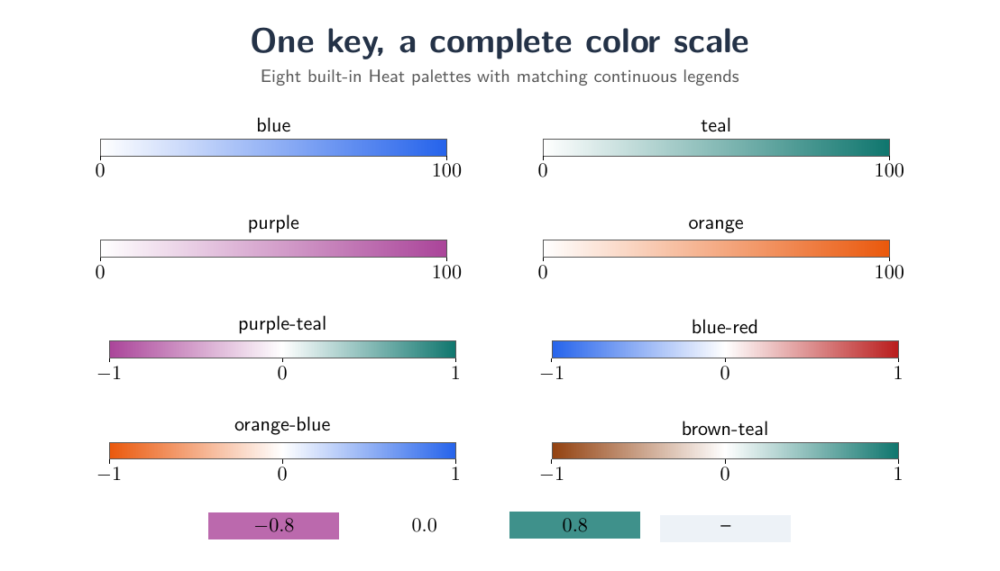

例如 `heat palette=purple-teal` 自动设置紫—白—青的发散配色，不必逐一指定两端和中心颜色。单元格与图例可通过命名组共享尺度和颜色，使用 `legend missing=false` 可隐藏图例中的缺失项。

[共享图例接口](docs/legends.md) · [上述四张展示图的完整源码与重建命令](docs/images/readme-gallery.tex)

### 服务响应时间与状态图例

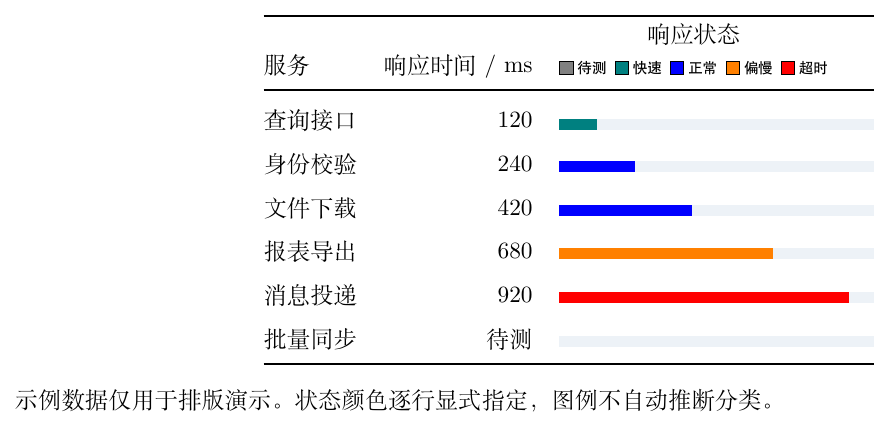

这是 `service-response-legend-v1.1.1` 的实际编译效果。`\gradtablelegendhead` 将标题与横向色块图例组合为表头；`table legend=false` 可隐藏图例行并保留标题。示例逐行指定状态颜色，未测数据使用 `NA`。

[完整示例源码](docs/examples/service-response-legend.tex) · [图片重建方法](docs/images/service-response-legend.md)

### 地区输入与两级报告

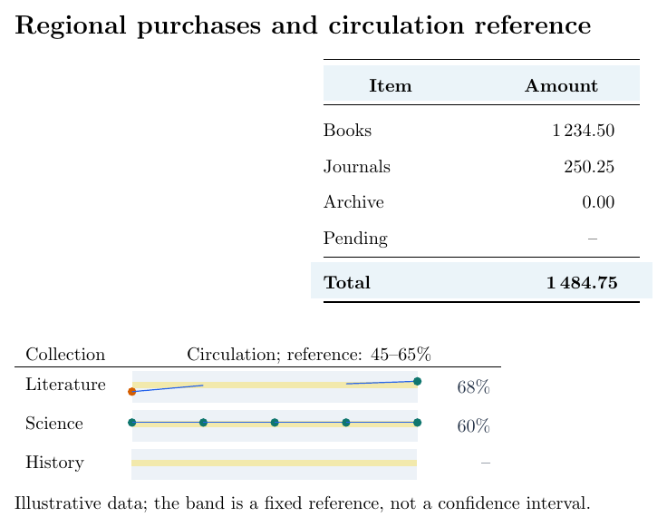

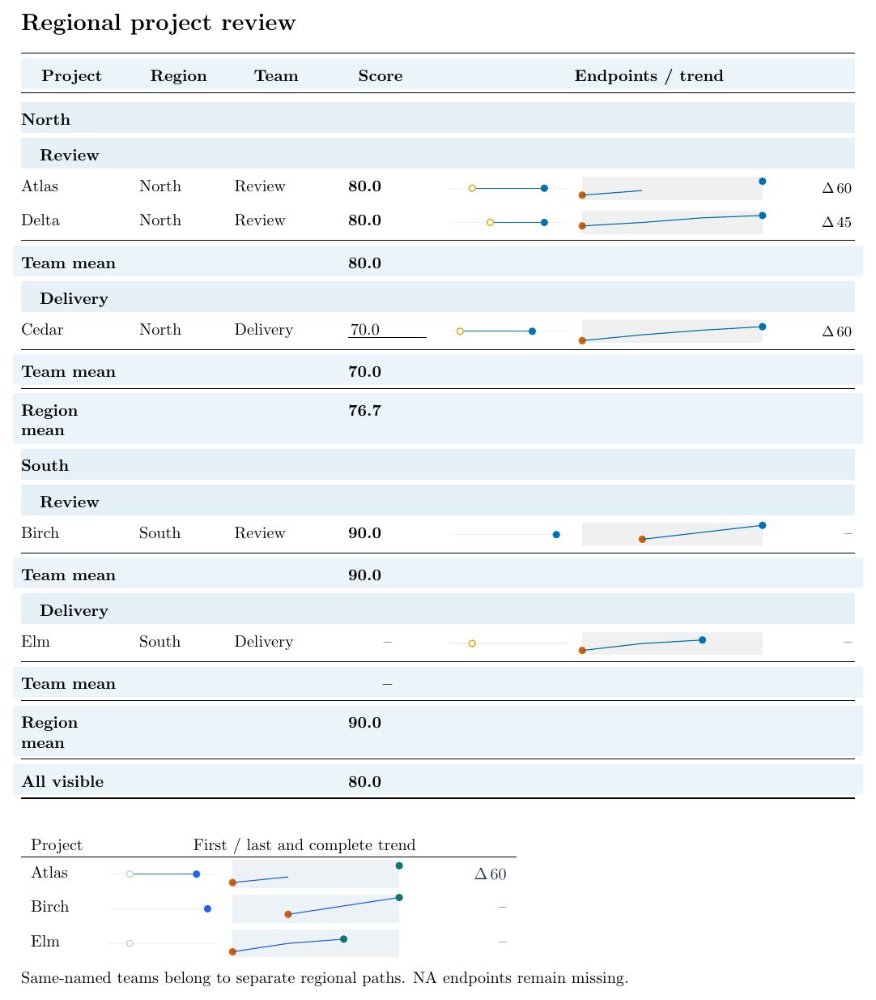

- [显式地区输入](docs/regional-input.md)：按列声明小数与分组符号，规范数值统一用于筛选、排序、排名、尺度和汇总；新增 regional 表格预设。
- [固定参考带与首末趋势组合](docs/trend-compositions.md)：完整保留缺失位置，共用明确尺度。
- [两级 CSV 报告](docs/hierarchical-tables.md)：结构化组路径、父级或叶级排名、独立摘要作用域；新增 hierarchical 预设及[跨页示例](docs/examples/hierarchical-longtable.tex)。
- 可编译示例：[中文地区输入](docs/examples/regional-input-cn.tex) / [English](docs/examples/regional-input.tex)，[中文层级报告](docs/examples/hierarchical-teams-cn.tex) / [English](docs/examples/hierarchical-teams.tex)。

### 可读性与目标趋势

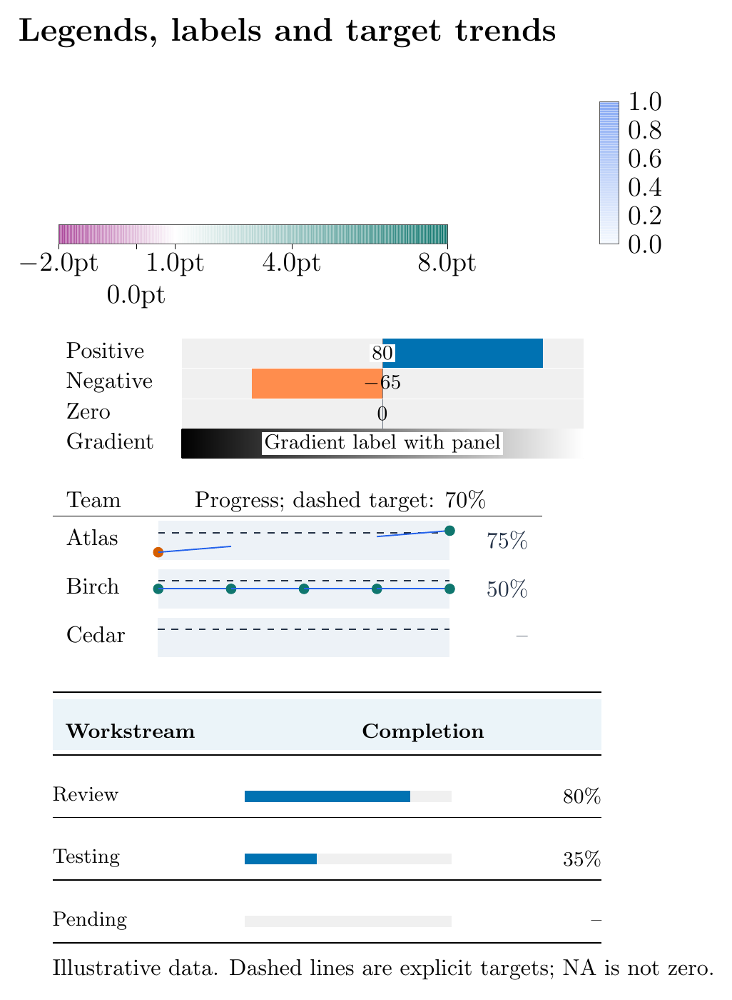

图例布局与对比度评估均显式启用；`\gradsparktarget` 将观测与目标分开，缺失位置仍保留。
[用法与边界](docs/readability.md) · [独立示例](docs/examples/readability-target-cn.tex) · [图片重建](docs/images/readability-target.md)

</details>

## 安装与按需加载


支持 LaTeX 2025-11-01+、expl3 2025-12-29+ 和 PGF/TikZ 3.1.11a+。较旧发行版请先更新。

宏包已被 CTAN 收录。使用由 `tlmgr` 管理的 TeX Live 或 MacTeX 时：

```sh
tlmgr install gradbars
```

更新已安装的宏包或查看信息：

```sh
tlmgr update gradbars
tlmgr info gradbars
```

TeX Live 仓库中的版本可能晚于 CTAN 或仓库开发版，请核对安装版本。手动安装时，将 `sty/` 中全部 `.sty` 文件（包括可选适配库 `tblrlibgradbars.sty`）一起放到主 `.tex` 文件旁，或安装到本地 TEXMF 的 `tex/latex/gradbars/` 目录；不要只复制主文件或混用不同版本的模块。

支持 pdfLaTeX、XeLaTeX 和 LuaLaTeX。依赖包括 PGF/TikZ、xparse 和 expl3；CSV 收集列与专属表格还会加载 collcell、array、booktabs、colortbl 和 longtable。siunitx 为可选依赖，宏包本身不加载 ctex 或 fontspec。

默认加载 `stack,spark,heat,csv,table` 五库。`distribution`、`legend`、`reports`、`pgfplotstable` 按需加载；tabularray 适配通过其自身库入口启用。

```latex
\usepackage[libraries=none]{gradbars}
\usegradbarslibrary{stack,spark} % 在导言区加载
```

`core` 始终加载。`table` 自动加载 stack、spark、heat、csv；`all` 和 `none` 是宏包选项模式值，不是库名。[模块与安装说明](sty/README.md)

## 使用约定

- 比较同一指标时使用一致的范围；数字格式化只影响显示，不改变筛选、排名、统计或几何计算。
- 零是有效数据，`NA` 表示缺失。CSV 按字符读取，不执行字段中的 TeX；地区数字须显式声明分隔规则。
- 趋势按等间隔位置绘制，并保留缺失位置；多页表放在单栏正文中，使用 `long=true`。
- 自动替代文本覆盖图形；表格结构和整篇文档的无障碍合规需另行验证。[支持范围](docs/accessibility.md)

## 文档与开发

- 当前手册源码：[中文主文件](docs/gradbars-manual.tex) · [中文章节索引](docs/Chapter/zh-cn/README.md) · [英文主文件](docs/gradbars-manual-en.tex) · [英文章节索引](docs/Chapter/en/README.md)。
- 已发布 PDF（v1.1.0）：[中文手册](https://github.com/Tape5try/gradbars/releases/download/v1.1.0/gradbars-manual-v1.1.0.pdf) · [英文手册](https://github.com/Tape5try/gradbars/releases/download/v1.1.0/gradbars-manual-en-v1.1.0.pdf)。仓库版本的手册可本地构建。
- 参考：[API](docs/api.md) · [稳定接口](docs/stability.md) · [v1.2.3 升级说明](docs/migration-v1.2.3.md) · [变更记录](CHANGELOG.md)。
- 开发：[模块目录](sty/README.md) · [开发指南](docs/developer.md) · [性能记录](docs/performance-v1.2.2.md) · [效果图重建](docs/images/readme-gallery.tex)。

从仓库根目录运行：

```sh
texlua scripts/source.lua --check
l3build check
texlua scripts/check.lua
texlua scripts/docs-check.lua
l3build doc
```

运行源码以 `sty/` 为准；`texlua scripts/source.lua` 生成 dtx/ins，源码包通过 `texlua scripts/unpack.lua` 提取完整运行模块。构建使用 TeX Live 的 texlua、l3build 与 latexmk，不依赖 Python。详细测试、安装及交付规则见[开发指南](docs/developer.md)。

## 反馈与许可

请通过 [GitHub Issues](https://github.com/Tape5try/gradbars/issues) 提交最小 `.tex` 示例、引擎、宏包版本和相关日志。

作者与维护者：SuFan（GitHub：Tape5try）。宏包与原创源码采用 [MIT](LICENSE)。[Precision/Recall 示例](docs/examples/precision-recall.tex) 含署名的 CC BY-SA 4.0 改编内容，许可范围见其源码开头；此例外不改变宏包运行时的许可。
