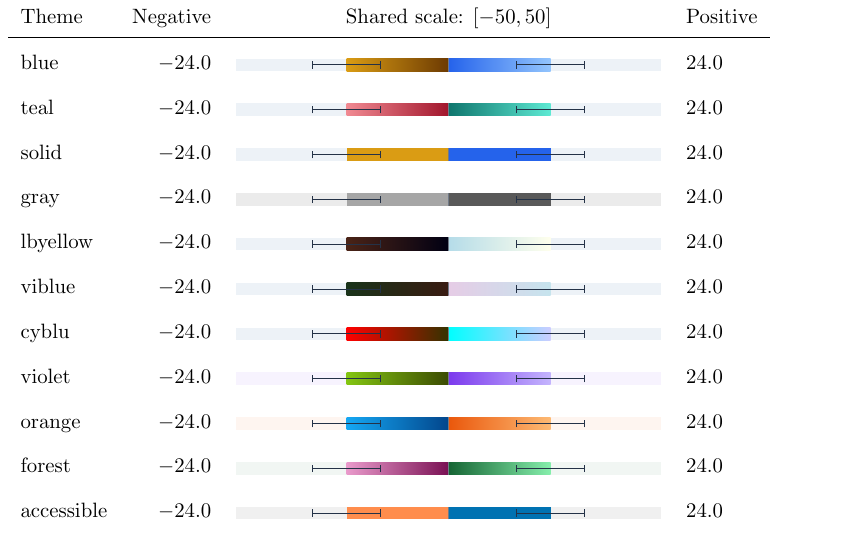
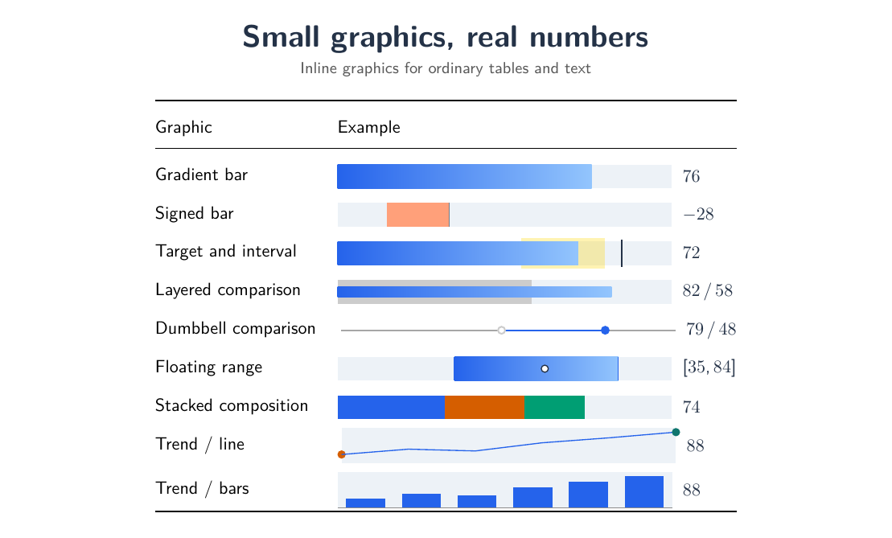
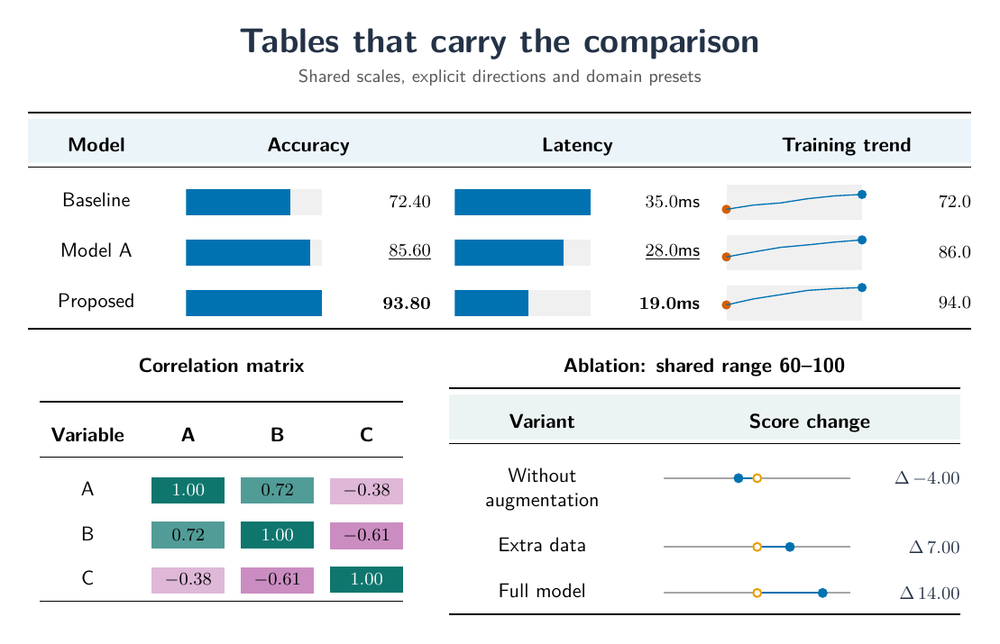
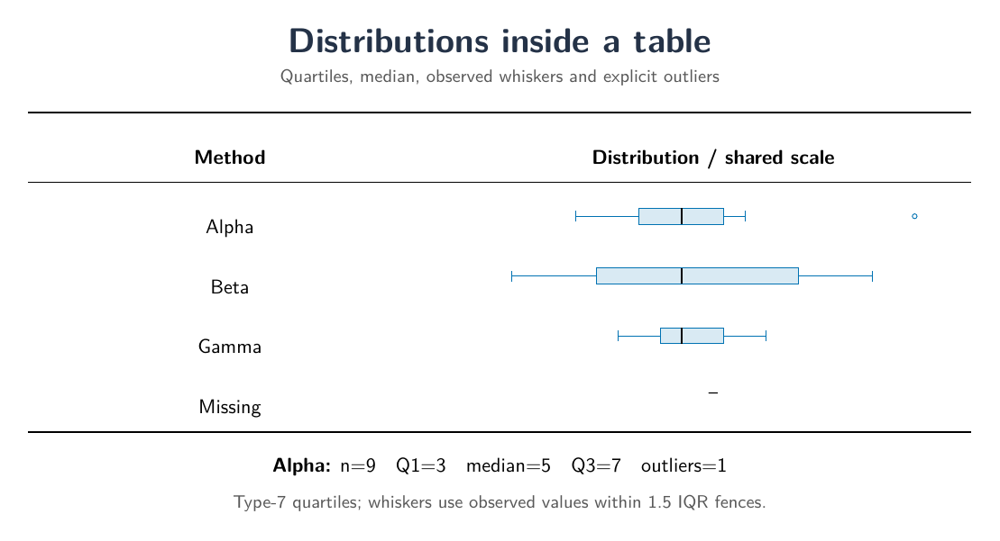
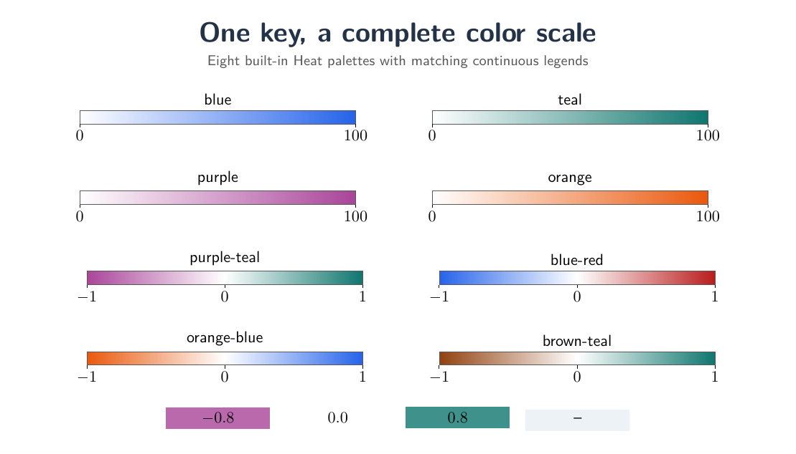

# gradbars

**在 LaTeX 正文和表格中呈现数值、比较、组成与趋势。**

**v1.1.1 · pdfLaTeX / XeLaTeX / LuaLaTeX · MIT**

开发版更新于 2026-10-27，尚未发布 v1.1.1 正式版本。修复源码提取、归档检查和文档一致性，并新增显式启用的表头组装图例；保留已有接口与默认数据语义。下方下载链接仍指向已发布的 v1.1.0。

[English](README.en.md) · [已发布中文手册（v1.1.0）](https://github.com/Tape5try/gradbars/releases/download/v1.1.0/gradbars-manual-v1.1.0.pdf) · [已发布英文手册（v1.1.0）](https://github.com/Tape5try/gradbars/releases/download/v1.1.0/gradbars-manual-en-v1.1.0.pdf) · [CTAN](https://ctan.org/pkg/gradbars)


gradbars 基于 PGF/TikZ，既可将单个图形嵌入现有 `tabular`，也可通过 `gradtable` 声明列并填写数据，生成可视化表格。无需手动包裹 `tikzpicture`，无需开启 shell escape。

显式设置 `theme=blue` 等条形主题时，负值自动采用互补色；支持全部 11 个主题，未选主题的默认负值保持浅红纯色。主题后可用 `negative fill=solid,negative color=lightred` 恢复原有负值外观。[正负主题完整对照](docs/examples/theme-complements.tex)。

内置正负同轨命令：`\gradsignedbar[min=-50,max=50,error=8,theme=blue]{-24}{24}`。无需自定义裁剪宏；两个观测值共用轨道和零线，各自保留误差区间。

## 主要能力

- **内嵌图形**：数据条、正负条、棒棒糖、比较条、哑铃、子弹图、区间、堆叠条、趋势图与 Heat 色阶。
- **可视化表格**：自动列宽、独立表头对齐、多级表头、分组、最佳与次佳值标记、统计汇总和跨页排版。
- **数据处理**：CSV 字段绑定、排序、筛选、分组、自动列尺度和命名共享尺度。
- **数字与外观**：科学计数输入、可选 siunitx 格式化、小数点对齐、主题、纹理、表格样式与图例。
- **无障碍与扩展**：启用 LaTeX PDF tagging 后自动生成图形替代文本，支持 `alt` 覆盖；提供稳定的图形、格式化器和第三方库注册接口。

## 效果展示

以下图片由宏包示例实际编译生成，使用演示数据。图形保留数值标签，可直接嵌入正文或表格；点击图片可查看大图。

### 正负同轨主题（v1.1.1）



上图使用内置命令 `\gradsignedbar[theme=blue,label=none]{-24}{24}`；各行共用 `min=-50,max=50,error=8,width=72mm`，仅切换主题名称。两侧数值由表格单独显示，负值采用互补色。

[完整主题示例](docs/examples/theme-complements.tex) · [图片重建方法](docs/images/theme-complements.md)

### 内嵌图形：数值、比较、组成与趋势



单个数据条只需 `\gradbar[max=100]{76}`；比较用 `\graddumbbell{48}{79}`，组成用 `\gradstack{32,24,18}`。相同宽度与范围便于在多行之间比较。

### 可视化表格：模型指标、相关矩阵与消融实验



同一张表可同时呈现指标条、数值和训练趋势。可选 `reports` 库提供相关矩阵、消融实验和指标表预设；准确率越高越好、延迟越低越好，分别按原始数值判断。

[领域报告接口](docs/reports.md) · [完整报告示例](docs/examples/domain-reports.tex) · [普通表格只写数字的示例](docs/examples/precision-recall.tex)

### 分布统计：箱线图与统计摘要



加载 `distribution` 后，`\gradboxplot{0,2,3,4,5,6,7,8,16}` 即可从样本绘制箱线图，也可直接填入表格列。四分位数采用 type-7 定义；须取 1.5 IQR 围栏内的实际观测，空心点表示离群点。`NA` 与零明确区分。

[统计定义与接口](docs/distributions.md)

### 配色与图例：一项设置切换完整色阶



例如 `heat palette=purple-teal` 自动设置紫—白—青的发散配色，不必逐一指定两端和中心颜色。单元格与图例可通过命名组共享尺度和颜色，使用 `legend missing=false` 可隐藏图例中的缺失项。

[共享图例接口](docs/legends.md) · [上述四张展示图的完整源码与重建命令](docs/images/readme-gallery.tex)

### 服务响应时间与状态图例（v1.1.1）


这是 `service-response-legend-v1.1.1` 的实际编译效果。`\gradtablelegendhead` 将标题与横向色块图例组合为表头；`table legend=false` 可隐藏图例行并保留标题。示例逐行指定状态颜色，未测数据使用 `NA`。

[完整示例源码](docs/examples/service-response-legend.tex) · [图片重建方法](docs/images/service-response-legend.md)

## 安装

支持 LaTeX 2025-11-01+、expl3 2025-12-29+ 和 PGF/TikZ 3.1.11a+。较旧发行版请先更新。

宏包已被 CTAN 收录。使用由 `tlmgr` 管理的 TeX Live 或 MacTeX 时：

```sh
tlmgr install gradbars
```

更新已安装的宏包或查看信息：

```sh
tlmgr update gradbars
tlmgr info gradbars
```

TeX Live 仓库中的版本可能晚于 CTAN 或仓库开发版，请核对安装版本。手动安装时，将 `sty/` 中全部 `.sty` 文件（包括可选适配库 `tblrlibgradbars.sty`）一起放到主 `.tex` 文件旁，或安装到本地 TEXMF 的 `tex/latex/gradbars/` 目录；不要只复制主文件或混用不同版本的模块。

支持 pdfLaTeX、XeLaTeX 和 LuaLaTeX。依赖包括 PGF/TikZ、xparse 和 expl3；CSV 收集列与专属表格还会加载 collcell、array、booktabs、colortbl 和 longtable。siunitx 为可选依赖，宏包本身不加载 ctex 或 fontspec。

## 快速开始

以下完整示例可直接编译：

```latex
\documentclass{article}
\usepackage{gradbars}
\begin{document}
\gradbar[max=100,width=30mm,precision=1]{72.4}

\begin{gradtable}[width=\linewidth,header align=c]
  \gradcolumn{method}{Method}
  \gradcolumn[type=bar,mark=both,
    options={max=100,precision=1}]{score}{Score}
  \gradcolumn[type=number,mark=best,
    options={better=lower,precision=1}]{time}{Time / ms}
  \gradrow{Baseline,72.4,18.2}
  \gradrow{Proposed,92.7,11.5}
  \gradrow{Pending,NA,NA}
\end{gradtable}
\end{document}
```

得分越高越好，耗时越低越好。`mark=both` 标记最佳与次佳值，`NA` 表示缺失而不是零。中文内容可使用 XeLaTeX 与 `ctexart`。

## 按需加载

默认 `\usepackage{gradbars}` 加载 `stack,spark,heat,csv,table` 五个功能库；`distribution,legend,reports` 按需加载。也可显式选择库：

```latex
\usepackage[libraries={stack,spark,heat,csv,table}]{gradbars}
```

| 库 | 提供的功能 |
| :---: | --- |
| `core` | 基础图形、数值处理、设置和无障碍标记；始终加载 |
| `stack` | 正负堆叠、分段标签与图例 |
| `spark` | 折线、柱形与 win-loss 趋势图 |
| `heat` | 连续与发散色阶单元格 |
| `csv` | CSV 导入、单元格访问和收集列 |
| `table` | 专属可视化表格；自动加载前四个功能库 |

只需要基础图形时使用 `libraries=none`。后续库加载必须放在导言区：

```latex
\usepackage[libraries=none]{gradbars}
\usegradbarslibrary{stack,spark}
```

`all` 和 `none` 是 `libraries` 的模式值，不是库名。`\gradbarsset` 与 `\gradbarssetup` 均可设置当前作用域的默认选项。

## 普通表格：单元格只写数字

```latex
\gradbarscolumn*{G}{max=1,width=14mm,precision=3,theme=gray}
\begin{tabular}{lGG}
Method & \gradbarshead{Precision} & \gradbarshead{Recall}\\
Alpha & 1.000 & 0.968\\
Beta & & 0.750\\
\end{tabular}
```

星号接口提供格内居中标签；空白保持空白，`NA` 表示缺失。无需手写 `collectcell`。详见[普通表格说明](docs/tabular-columns.md)及[完整示例](docs/examples/precision-recall.tex)。

表头下的横向类别图例可直接使用内置命令，不再手写色块宏或嵌套表格：

```latex
\gradbarssetup{table legend=true} % false 隐藏图例行，保留标题
\gradtablelegendhead[
  stack colors={gray,teal,blue,orange,red}
]{响应状态}{待测,快速,正常,偏慢,超时}
```

仅需色块行时用 `\gradtablelegend[选项]{名称列表}`。两个命令都随 core 提供，无需加载 `legend` 库；颜色说明由用户声明，不会自动改变数据条颜色。[完整服务响应时间表](docs/examples/service-response-legend.tex)与[图例配置](docs/legends.md)。

## 普通表格中的文字基线

在 `tabular` 中，让图中标签与旁边普通数字对齐时，请显式设置：

```latex
\gradbarssetup{width=30mm,max=100,precision=1,baseline=text}
```

默认 `baseline=auto` 保留原有图形位置，升级版本不会自动切换对齐模式。
`baseline=text` 在 v1.1.0 中已可用。[完整对齐示例](docs/examples/baseline-alignment.tex)。

## tabularray 集成

需要 tabularray 2025C（2025-11-27）或更新版本，在导言区加载：

```latex
\usepackage{tabularray}
\usepackage{gradbars}
\UseTblrLibrary{gradbars}
```

`G[选项]{宽度}`、`H[选项]{宽度}`、`N[选项]{宽度}`、`D[选项]{宽度}` 分别提供条形、Heat、数字和双层比较列。表头用 `{...}` 保护。`\gradbarTblr` 等单元格命令也可用于现有 `Q`、`X` 列；`label align=cell` 将 inside/auto 标签放在整个内容区域的中心，`label=left` 保留左侧格式化数值与单位。`gradtblr` 环境提供独立的预设样式，原生 `gradtable` 可使用 `style=matrix`。普通文档不自动加载 tabularray。完整示例见中英文手册的独立集成章节。

## 数据与排版约定

- 比较同一指标时使用一致的范围；自动趋势范围主要用于比较形状，比较绝对水平时应固定尺度。
- 数字格式化不改变原始数据计算。`unit` 附加文本，`value format=percent` 计算值相对于 `max` 的比例。
- CSV 接受逗号分隔的单行字段，字段按字符读取，不作为 TeX 执行。趋势图使用等间隔观测，不解析日期。
- 正负堆叠分别累积；默认标签为净值，分段百分比表示绝对贡献的份额。
- `long=true` 支持专属表格跨页；跨页表格应放在单栏正文中，不能置于浮动体或 `minipage`。
- 自动替代文本只覆盖图形；完整文档的阅读顺序、表格结构和其他无障碍要求需另行验证。

可选 `reports` 库提供相关系数矩阵、消融实验与指标表预设，详见[领域报告](docs/reports.md)。开发者可使用[第三方库模板](docs/libraries/starter/README.md)及[公开后端契约](docs/backends.md)扩展宏包。

## 文档与开发

中英文手册均提供效果与源码对照，包含入门、图形、外观、表格、应用案例和参考。

- [中文主文件](docs/gradbars-manual.tex)与[中文章节](docs/Chapter/zh-cn/README.md)。
- [完整表格案例](docs/examples/README.md)：课程完成进度、借阅渠道构成、能耗前后对比与批次尺寸分布，均附独立源码。
- [英文主文件](docs/gradbars-manual-en.tex)与[英文章节](docs/Chapter/en/README.md)。
- [API 参考](docs/api.md)、[开发者指南](docs/developer.md)、[v1.1.1 维护说明](docs/migration-v1.1.1.md)和[v1.1.0 迁移指南](docs/migration-v1.1.0.md)。
- [稳定接口契约](docs/stability.md)：公开接口范围、覆盖顺序、兼容性和弃用约定。
- [已发布源码说明（v1.1.0）](https://github.com/Tape5try/gradbars/releases/download/v1.1.0/gradbars-source-v1.1.0.pdf)：l3doc 文档与 docstrip 源码流程；当前版本可本地构建。
- [变更记录](CHANGELOG.md)：版本新增、修复与兼容性变化。

运行模块集中在 `sty/`，第三方库示例位于 `docs/libraries/`。从仓库根目录执行：

```sh
l3build check
texlua tests/maintenance.lua
texlua scripts/docs-check.lua
texlua scripts/check.lua
texlua scripts/source.lua --check
l3build doc
```

构建使用 TeX Live 自带的 texlua、l3build 和 latexmk，不依赖 Python。中文手册使用 XeLaTeX，英文手册与源码说明使用 pdfLaTeX；latexmk 自动判断重编译次数。PDF 不提交到 Git，通过 GitHub Release 下载。

`gradbars.dtx` 与 `gradbars.ins` 是可复现的发行源码。运行 `texlua scripts/unpack.lua` 可自动创建 `sty/` 并提取全部 22 个运行模块；根目录不生成 `.sty` 文件。若保留发行包中的 `sty/README.md`，也可直接运行 `tex gradbars.ins`。两种方式均无需开启 shell escape。
开发时修改 `sty/` 后运行 `texlua scripts/source.lua` 同步发行源码。
使用 `texlua scripts/pdf-check.lua` 检查实际 PDF 的替代文本、表格表头及跨行跨列结构。

发行与 CI 配置见 [上传限制及发布流程](docs/developer.md#release-configuration)。CTAN 源码包不含 Python 文件或由 `.dtx` 提取的运行时 `.sty`；GitHub 仓库保留完整 `sty/` 方便开发。

## 反馈与许可

通过 [GitHub Issues](https://github.com/Tape5try/gradbars/issues) 报告问题，请附最小 `.tex` 示例、编译引擎、宏包版本和相关日志。

作者与维护者：SuFan（GitHub：Tape5try）。宏包与原创源码采用 [MIT 许可证](LICENSE)。
[Precision/Recall 示例](docs/examples/precision-recall.tex) 含署名的 CC BY-SA 4.0 改编内容，许可范围见该文件开头；不将此例外扩展到宏包运行时。

[分布统计](docs/distributions.md) · [共享图例](docs/legends.md) · [无障碍支持范围](docs/accessibility.md)
